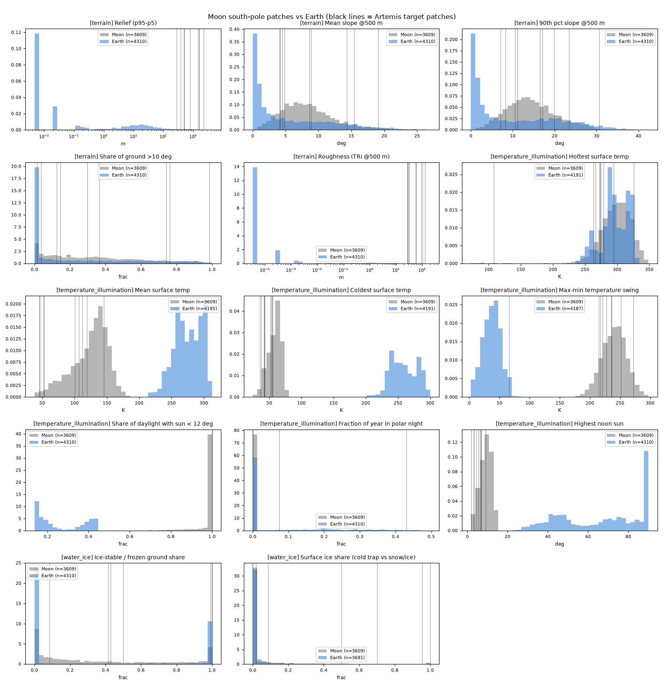

# Data profile: Moon vs Earth, by analog category

- **Moon:** 3609 south-pole patches (10 x 10 km, lat <= -80), incl. 9 Artemis target patches.
- **Earth:** patch-level (4310 Earth patches).

Read this before choosing models. *Overlap* = share of one body's patches whose value falls inside the other body's 1st-99th percentile range. **Overlap near 0 means a direct distance is meaningless** for that feature: the score must instead be a calibrated 'closest approach' (how near Earth gets), and the gap itself is a finding to report.

## 1. Shared features: do Moon and Earth values even overlap?

| Category | Feature | Moon p5 / p50 / p95 | Earth p5 / p50 / p95 | Moon in Earth range | Earth in Moon range | Gap | Coverage M / E |
|---|---|---|---|---|---|---|---|
| terrain | Relief (p95-p5) (m) | 215.92 / 925.29 / 2,373.23 | 10.89 / 243.49 / 1,380.20 | 86% | 64% | 0.00 | 100% / 100% |
| terrain | Mean slope @500 m (deg) | 2.74 / 7.89 / 16.07 | 0.14 / 2.79 / 17.44 | 100% | 58% | 0.00 | 100% / 100% |
| terrain | 90th pct slope @500 m (deg) | 5.57 / 13.87 / 25.33 | 0.24 / 5.98 / 28.56 | 100% | 54% | 0.00 | 100% / 100% |
| terrain | Share of ground >10 deg (frac) | 0.01 / 0.29 / 0.85 | 0.00 / 0.02 / 0.83 | 98% | 100% | 0.00 | 100% / 100% |
| terrain | Roughness (TRI @500 m) (m) | 18.95 / 52.35 / 107.78 | 0.93 / 19.03 / 124.61 | 100% | 56% | 0.00 | 100% / 100% |
| temperature_illumination | Hottest surface temp (K) | 260.91 / 299.88 / 331.71 | 256.46 / 294.78 / 324.14 | 90% | 100% | 0.00 | 100% / 97% |
| temperature_illumination | Mean surface temp (K) | 66.95 / 129.90 / 159.84 | 240.27 / 275.71 / 303.66 | 0% | 0% | 52.42 | 100% / 97% |
| temperature_illumination | Coldest surface temp (K) | 40.77 / 60.33 / 71.54 | 230.80 / 257.39 / 290.82 | 0% | 0% | 137.53 | 100% / 97% |
| temperature_illumination | Max-min temperature swing (K) | 204.75 / 240.88 / 272.98 | 12.11 / 38.09 / 61.88 | 0% | 0% | 119.09 | 100% / 97% |
| temperature_illumination | Share of daylight with sun < 12 deg (frac) | 0.89 / 1.00 / 1.00 | 0.14 / 0.21 / 0.43 | 0% | 0% | 0.36 | 100% / 100% |
| temperature_illumination | Fraction of year in polar night (frac) | 0.00 / 0.00 / 0.00 | 0.00 / 0.00 / 0.34 | 100% | 88% | 0.00 | 100% / 100% |
| temperature_illumination | Highest noon sun (deg) | 4.02 / 9.42 / 13.34 | 34.31 / 69.67 / 89.97 | 0% | 0% | 13.77 | 100% / 100% |
| water_ice | Ice-stable / frozen ground share (frac) | 0.00 / 0.23 / 1.00 | 0.00 / 0.00 / 1.00 | 100% | 100% | 0.00 | 100% / 100% |
| water_ice | Surface ice share (cold trap vs snow/ice) (frac) | 0.00 / 0.00 / 0.24 | 0.00 / 0.00 / 0.35 | 99% | 98% | 0.00 | 100% / 86% |

## 2. One-sided / text features: coverage

| Category | Feature | Moon coverage | Earth coverage |
|---|---|---|---|
| geology | `moon_geo_unit` | 100% | not yet |
| geology | `geo_frac_crater` | 100% | not yet |
| geology | `geo_frac_basin` | 100% | not yet |
| geology | `geo_frac_terra` | 100% | not yet |
| geology | `geo_frac_plains` | 100% | not yet |
| geology | `mstrat_lith` | n/a | 90% |
| geology | `mstrat_descrip` | n/a | 54% |
| geology | `sg_sand_pct` | n/a | 81% |
| geology | `sg_silt_pct` | n/a | 81% |
| geology | `sg_clay_pct` | n/a | 81% |
| geology | `sg_bdod_g_cm3` | n/a | 80% |
| geology | `sg_cfvo_pct` | n/a | 81% |
| biology_habitability | `ndvi_mean` | n/a | 83% |
| biology_habitability | `ndvi_max` | n/a | 83% |
| biology_habitability | `precip_best_mm_yr` | n/a | 92% |
| biology_habitability | `soil_moist_mean` | n/a | 78% |
| biology_habitability | `power_uv_index` | n/a | 62% |
| biology_habitability | `wc_frac_tree` | n/a | 86% |
| water_ice_earth | `pf_frac_pct` | n/a | 42% |
| water_ice_earth | `pf_magt_2m_c` | n/a | 42% |
| water_ice_earth | `wc_frac_snow_ice` | n/a | 86% |
| water_ice_earth | `power_frost_days` | n/a | 62% |
| dust_surface | `aot_mean` | n/a | 91% |
| dust_surface | `sg_silt_pct` | n/a | 81% |
| dust_surface | `sg_clay_pct` | n/a | 81% |
| dust_surface | `wc_frac_bare_sparse` | n/a | 86% |
| operations | `slope500_p90_deg` | 100% | 100% |
| operations | `frac_slope500_gt20` | 100% | 100% |
| operations | `lola_frac_psr` | 100% | not yet |
| operations | `lola_frac_sunlit_gt50pct` | 100% | not yet |

## 3. Moon patch structure (what the encoders will see)

- Numeric Moon features: 52 (after dropping constants: geo_frac_mare).
- PCA: 11 components explain 80% of variance, 22 explain 95%. Small intrinsic dimension = small encoders are enough.
- Near-duplicate pairs (|r| > 0.95), keep one of each: `noon_elev_max_deg`~`noon_elev_min_deg` (1.0), `mean_day_elev_deg`~`noon_elev_min_deg` (1.0), `noon_elev_mean_deg`~`noon_elev_min_deg` (1.0), `mean_day_elev_deg`~`noon_elev_max_deg` (1.0), `dvn_frac_ice_stable`~`dvn_frac_ice_within_1m` (1.0), `frac_polar_day`~`frac_polar_night` (1.0), `mean_day_elev_deg`~`noon_elev_mean_deg` (1.0), `noon_elev_max_deg`~`noon_elev_mean_deg` (1.0), `slope500_mean_deg`~`tri500_mean_m` (0.999), `dvn_frac_coldtrap_110k`~`dvn_frac_ice_surface` (0.999), `slope_native_mean_deg`~`tri500_mean_m` (0.996), `slope500_mean_deg`~`slope_native_mean_deg` (0.995)

## 4. Sanity preview: nearest Earth terrain for each Artemis target (plain z-score distance, not the model)

| Moon target | Nearest Earth (terrain only) | 2nd | 3rd |
|---|---|---|---|
| moon_shackleton | Tupungatito (0.17) | antarctic_ice_free sample 170 (0.25) | Fogo (0.25) |
| moon_peak_cabeus_b | antarctic_ice_free sample 310 (0.05) | Prince Edward Island (0.09) | antarctic_ice_free sample 151 (0.10) |
| moon_haworth | Melbourne (0.70) | La Palma (0.70) | Makushin (0.82) |
| moon_malapert_massif | bare_midlat sample 240 (0.13) | Etna (0.16) | Jefferson (0.16) |
| moon_mons_mouton | sparse_cold sample 200 (0.06) | ice_edge sample 158 (0.09) | sparse_cold sample 151 (0.09) |
| moon_mons_mouton_plateau | Nazko (0.05) | sparse_cold sample 12 (0.07) | sparse_cold sample 43 (0.09) |
| moon_nobile_rim | Niseko (0.10) | Ibu (0.10) | Inielika (0.13) |
| moon_de_gerlache_rim2 | ice_edge sample 205 (0.23) | Tombel Graben (0.26) | antarctic_ice_free sample 236 (0.27) |
| moon_slater_plain | antarctic_ice_free sample 393 (0.07) | antarctic_ice_free sample 372 (0.10) | antarctic_ice_free sample 257 (0.11) |

## 5. What this means for the ML design

- **Relief (p95-p5)** (terrain): Moon-in-Earth-range 86% -> direct similarity OK.
- **Mean slope @500 m** (terrain): Moon-in-Earth-range 100% -> direct similarity OK.
- **90th pct slope @500 m** (terrain): Moon-in-Earth-range 100% -> direct similarity OK.
- **Share of ground >10 deg** (terrain): Moon-in-Earth-range 98% -> direct similarity OK.
- **Roughness (TRI @500 m)** (terrain): Moon-in-Earth-range 100% -> direct similarity OK.
- **Hottest surface temp** (temperature_illumination): Moon-in-Earth-range 90% -> direct similarity OK.
- **Mean surface temp** (temperature_illumination): Moon-in-Earth-range 0% -> NO overlap: use calibrated closest-approach + report the gap.
- **Coldest surface temp** (temperature_illumination): Moon-in-Earth-range 0% -> NO overlap: use calibrated closest-approach + report the gap.
- **Max-min temperature swing** (temperature_illumination): Moon-in-Earth-range 0% -> NO overlap: use calibrated closest-approach + report the gap.
- **Share of daylight with sun < 12 deg** (temperature_illumination): Moon-in-Earth-range 0% -> NO overlap: use calibrated closest-approach + report the gap.
- **Fraction of year in polar night** (temperature_illumination): Moon-in-Earth-range 100% -> direct similarity OK.
- **Highest noon sun** (temperature_illumination): Moon-in-Earth-range 0% -> NO overlap: use calibrated closest-approach + report the gap.
- **Ice-stable / frozen ground share** (water_ice): Moon-in-Earth-range 100% -> direct similarity OK.
- **Surface ice share (cold trap vs snow/ice)** (water_ice): Moon-in-Earth-range 99% -> direct similarity OK.
